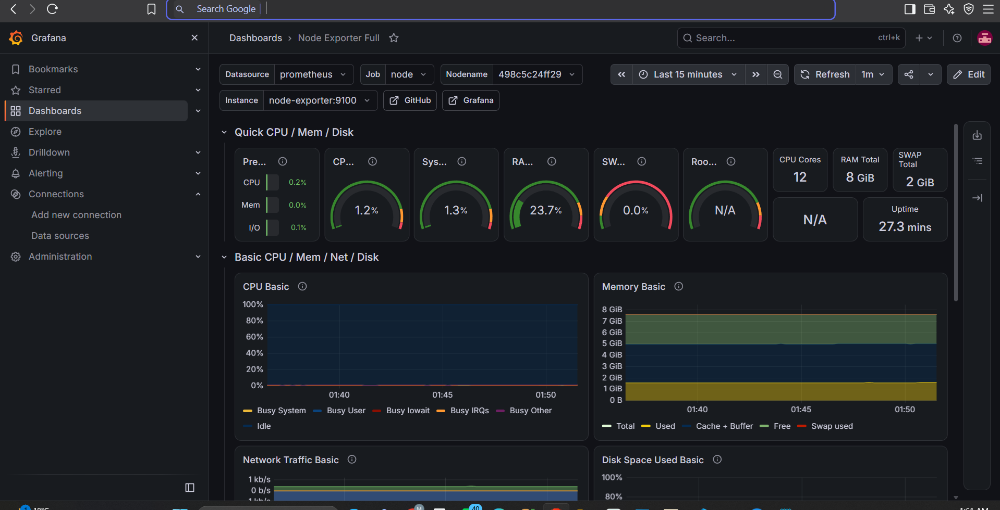
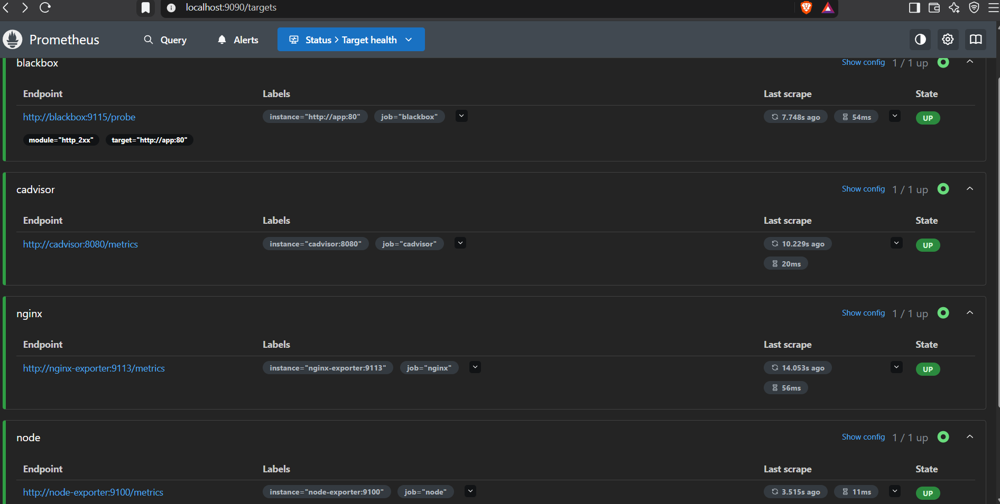
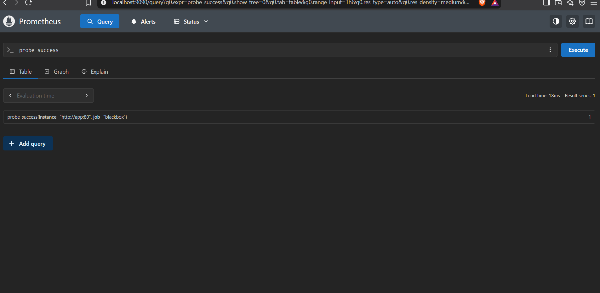
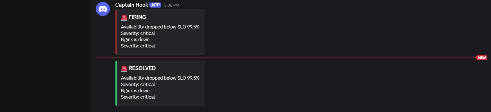

# Monitoring & Observability Lab

Full monitoring stack running on Docker Compose.

## Stack
- Prometheus: metrics collection
- Grafana: dashboards
- Node Exporter: host metrics
- cAdvisor: container metrics
- Nginx: demo app
- (Next) Alertmanager + Discord

## Architecture
App/Host → Exporters → Prometheus → Grafana (dashboards)
                          ↓
                    Alert rules → Alertmanager → Discord

## Run
    docker compose up -d

| Service | URL |
|---|---|
| Prometheus | http://localhost:9090 |
| Grafana | http://localhost:3000 |
| cAdvisor | http://localhost:8081 |

## Dashboards

## Alerts
| Alert | Condition | Severity |
|---|---|---|
| InstanceDown | up == 0 for 1m | critical |
| HighCPU | CPU > 80% for 2m | warning |

## SLI / SLO

| SLI | Query | SLO |
|---|---|---|
| Availability | avg_over_time(probe_success[5m]) | ≥ 99.5% |
| Latency | probe_duration_seconds | < 500ms |

Alerts: NginxDown, AvailabilitySLOBreach, LatencySLOBreach

## Testing
1. docker compose stop app
2. After ~2 min, NginxDown and AvailabilitySLOBreach fire.
3. docker compose start app → alerts resolve.

## Cloud Deployment

The stack was deployed on *AWS EC2*:
- Region: Europe (Stockholm) eu-north-1
- OS: Ubuntu Server 22.04
- Instance type: t3.micro (Free Tier)
- Docker and Docker Compose installed with the official script
- Deployed with git clone then docker compose up -d
- Security group: ports 22, 3000, 9090 and 9093 restricted to my IP only

